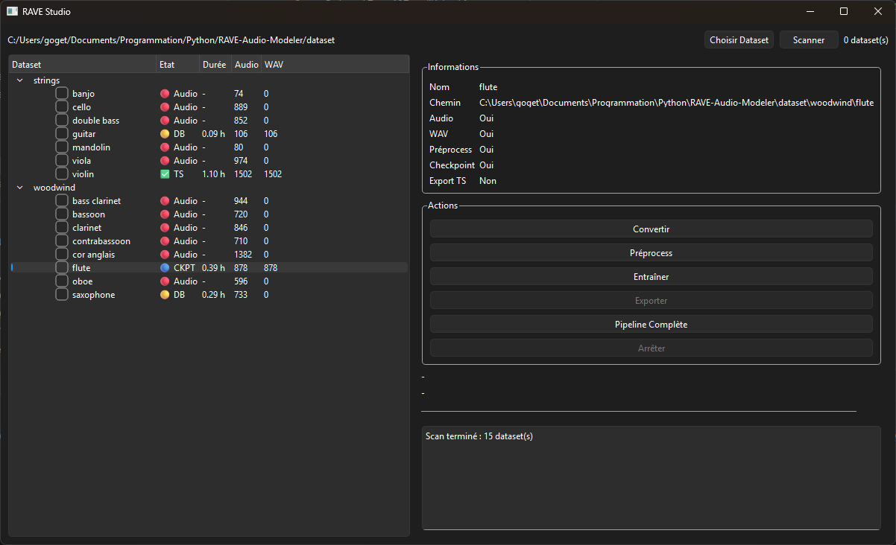
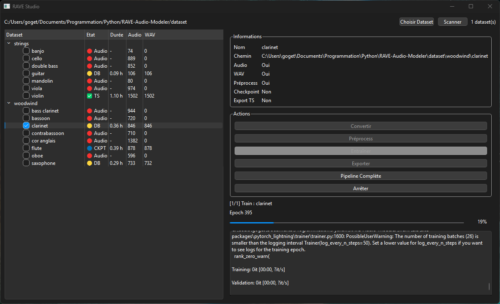
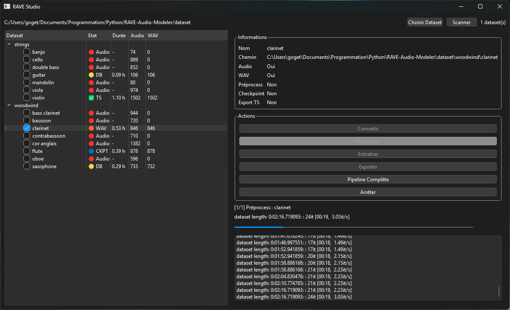
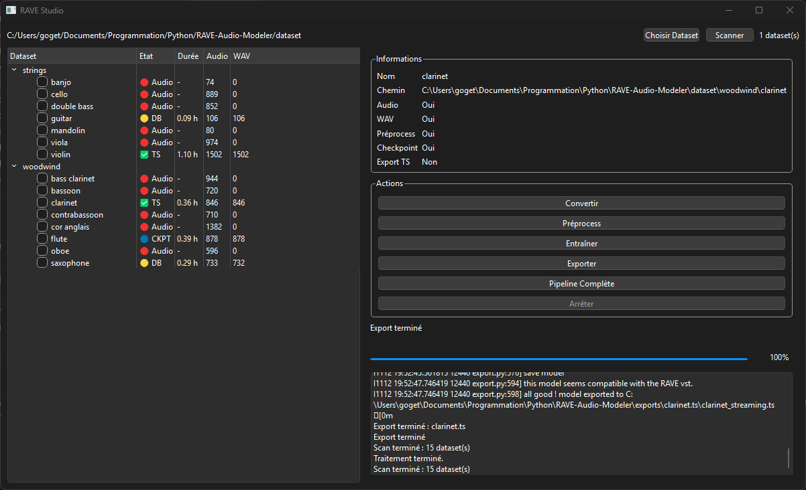

<div align="center">

# 🎵 RAVE Audio Modeler


### Interface graphique complète pour entraîner, exporter et gérer des modèles RAVE


Une application de bureau permettant de créer et entraîner facilement des modèles RAVE à partir de vos propres datasets audio, sans avoir à manipuler les commandes en ligne de commande.

</div>

---

# 📸 Captures d'écran

| Gestion des datasets | Entraînement |
|----------------------|--------------|
|  |  |

| Prétraitement | Export |
|--------------|---------|
|  |  |

---

# 🚀 Nouveautés de la version 1.0.0

La version 1.0 introduit la première chaîne de traitement complète permettant de créer un modèle RAVE de bout en bout.

### Nouvelles fonctionnalités

✅ Mode Pipeline complet

✅ Détection automatique de l'état des datasets

✅ Reprise automatique des checkpoints

✅ Export TorchScript Streaming

✅ Arrêt sécurisé des traitements

✅ Traitement multi-datasets

### Workflow complet

```text
Audio
 ↓
WAV
 ↓
DB
 ↓
CKPT
 ↓
TS
```

Le bouton **Pipeline** exécute automatiquement toutes les étapes nécessaires et ignore celles qui ont déjà été effectuées.

---

# 🚀 Présentation

**RAVE Audio Modeler** est une interface graphique développée avec **PySide6** qui simplifie l'ensemble du workflow RAVE.

Au lieu d'utiliser manuellement des commandes telles que :

```bash
rave preprocess
rave train
rave export
```

l'application prend en charge automatiquement :

- La gestion des datasets
- La conversion audio
- Le prétraitement RAVE
- L'entraînement des modèles
- La reprise des checkpoints
- L'export des modèles
- L'affichage des logs
- Le suivi de progression

Le tout depuis une seule interface utilisateur.

La version 1.0 ajoute également un mode **Pipeline entièrement automatisé** capable d'exécuter la conversion, le préprocess, l'entraînement et l'export en un seul clic.

---

# ✨ Fonctionnalités

## 📂 Gestion des datasets

Analyse automatiquement le dossier `dataset/` et affiche :

- Nom du dataset
- Nombre de fichiers audio
- Nombre de fichiers WAV
- Durée totale
- État de conversion
- État du prétraitement

Exemple :

```text
dataset/
├── guitare/
├── piano/
├── violon/
└── voix/
```

---

## 🎧 Conversion audio automatique

Conversion des formats :

- WAV
- MP3
- FLAC
- OGG
- AAC
- AIFF
- M4A

vers un format WAV compatible avec RAVE.

Pour chaque dataset, un sous-dossier `wav` est créé automatiquement :

```text
dataset/
└── guitare/
    ├── sample01.mp3
    ├── sample02.flac
    └── wav/
        ├── sample01.wav
        └── sample02.wav
```

Les fichiers originaux sont conservés.

---

## 📊 Statistiques des datasets

L'application calcule automatiquement :

- Nombre total de fichiers audio
- Nombre de fichiers WAV générés
- Durée réelle du dataset
- État du traitement

Ces informations permettent d'évaluer rapidement la qualité d'un dataset avant l'entraînement.

---

## 📊 Suivi automatique des datasets

Chaque dataset est automatiquement classé selon son état d'avancement.

| Statut | Description |
|----------|----------|
| 🔴 Audio | Dataset brut |
| 🟠 WAV | Audio converti |
| 🟡 DB | Préprocess terminé |
| 🔵 CKPT | Checkpoint disponible |
| ✅ TS | Export terminé |

Cela permet d'identifier immédiatement l'étape déjà réalisée pour chaque dataset.

---

## ⚙️ Prétraitement RAVE

L'application exécute automatiquement :

```bash
rave preprocess
```

Fonctionnalités :

✅ Création automatique des dossiers

✅ Affichage temps réel de la console

✅ Gestion des erreurs

✅ Suivi de progression

✅ Exécution dans un thread dédié

Exemple :

```bash
rave preprocess \
    --input_path dataset/guitare/wav \
    --output_path data/guitare \
    --lazy
```

---

## 🧠 Entraînement des modèles

Démarrez l'entraînement directement depuis l'interface.

Fonctionnalités :

- Affichage des logs RAVE
- Suivi des epochs
- Monitoring de progression
- Gestion des erreurs
- Arrêt propre de l'entraînement
- Reprise automatique des checkpoints

Exemple :

```bash
rave train data/guitare
```

---

## 🔄 Reprise automatique des checkpoints

Lorsqu'un entraînement est interrompu, l'application détecte automatiquement le dernier checkpoint disponible.

Exemple :

```text
runs/
└── guitar_e18d54798e/
    └── version_0/
        └── checkpoints/
            └── epoch-xxxx.ckpt
```

Le prochain lancement reprendra automatiquement l'entraînement au dernier point sauvegardé.

---

## 📦 Export des modèles

Export simplifié via :

```bash
rave export
```

Génération de fichiers :

```text
exports/
└── guitar.ts/
    └── guitar_streaming.ts
```

compatibles avec :

- RAVE VST
- Python
- Max/MSP
- Pure Data
- TorchScript
- Applications temps réel


---

## ⚡ Pipeline automatisée

La version 1.0 introduit une pipeline entièrement automatisée.

L'application exécute automatiquement toutes les étapes manquantes nécessaires à la génération d'un modèle TorchScript.

```text
Audio
 ↓
Conversion
 ↓
Préprocess
 ↓
Entraînement
 ↓
Export
```

Les étapes déjà terminées sont automatiquement ignorées.

Exemples :

```text
Audio → WAV → DB → CKPT → TS
```

```text
DB → CKPT → TS
```

```text
CKPT → TS
```

```text
TS → Aucun traitement nécessaire
```
---

## 🧵 Architecture multi-threads

Toutes les opérations lourdes sont exécutées dans des **QThreads dédiés** :

- Conversion
- Prétraitement
- Entraînement
- Export
- Pipeline

L'interface reste fluide même pendant des traitements de plusieurs heures.

---

## 📋 Affichage détaillé de la progression

Affichage en temps réel :

```text
Conversion : Guitare

[125/1502]
guitar_Fs3_15_fortissimo.wav
```

La console intégrée affiche les sorties complètes de :

- FFmpeg
- RAVE Preprocess
- RAVE Train
- RAVE Export

---

## 🛑 Arrêt sécurisé des traitements

Toutes les opérations longues peuvent être interrompues proprement depuis l'interface.

Tâches supportées :

- Conversion
- Préprocess
- Entraînement
- Export
- Pipeline

Les processus actifs sont arrêtés proprement tout en conservant une interface réactive.

---

---

# 📁 Structure du projet

```text
RAVE-Audio-Modeler/

├── dataset/
│   ├── guitare/
│   ├── piano/
│   ├── violon/
│   └── voix/
│
├── data/
│
├── runs/
│
├── exports/
│
├── models/
│
└── logs/
```

---

# 🔥 Workflow typique

## 1️⃣ Ajouter un dataset

Créer un dossier :

```text
dataset/guitare
```

et y copier vos fichiers audio.

---

## 2️⃣ Convertir

Cliquer sur :

```text
Convertir le dataset
```

Les fichiers WAV seront créés dans :

```text
dataset/guitare/wav
```

---

## 3️⃣ Prétraiter

Cliquer sur :

```text
Prétraiter le dataset
```

Les données nécessaires à l'entraînement seront générées dans :

```text
data/guitare
```

---

## 4️⃣ Entraîner

Cliquer sur :

```text
Entraîner le modèle
```

et suivre la progression en temps réel.

---

## 5️⃣ Exporter

Cliquer sur :

```text
Exporter le modèle
```

pour générer un modèle utilisable en temps réel.

---

## Alternative : Pipeline

Cliquer simplement sur :

```text
Pipeline
```

L'application exécutera automatiquement :

```text
Conversion
 ↓
Préprocess
 ↓
Entraînement
 ↓
Export
```

jusqu'à la génération du modèle TorchScript.

---

# 🎹 Types de datasets pris en charge

## Instruments

- Piano
- Guitare
- Violon
- Violoncelle
- Flûte
- Saxophone
- Trompette
- Batterie

## Voix

- Chant
- Narration
- Voix parlée
- Chœur
- Beatbox

## Sound Design

- Ambiances
- Textures
- Effets sonores
- Synthétiseurs
- Enregistrements de terrain

---

# 🛠 Prérequis

## Logiciels

- Python 3.10+
- FFmpeg
- PyTorch
- PyTorch Lightning
- RAVE
- PySide6

## GPU recommandé

Pour les grands datasets :

- Carte NVIDIA
- CUDA
- PyTorch compatible CUDA

L'entraînement CPU est possible mais nettement plus lent.

---

# 📦 Installation

Cloner le dépôt :

```bash
git clone https://github.com/WebCyberman/RAVE-Audio-Modeler.git

cd RAVE-Audio-Modeler
```

Créer un environnement virtuel :

```bash
python -m venv .venv
```

Activation :

### Windows

```bash
.venv\Scripts\activate
```

### Linux / macOS

```bash
source .venv/bin/activate
```

Installation des dépendances :

```bash
pip install -r requirements.txt
```
---

# 📌 Version

Version actuelle :

```text
v1.0.0
```

Première version stable intégrant le workflow complet RAVE.

```text
Audio
 ↓
WAV
 ↓
DB
 ↓
CKPT
 ↓
TS
```
---

---

# ⚠ Licence de RAVE

RAVE Audio Modeler est une interface graphique indépendante.

Le projet **RAVE** est développé par l'IRCAM et distribué sous la licence :

**Creative Commons Attribution-NonCommercial 4.0 International (CC BY-NC 4.0)**

L'utilisation de RAVE et des modèles associés reste soumise aux conditions de cette licence.

Dépôt officiel :

https://github.com/acids-ircam/RAVE

---

# 🙏 Remerciements

Ce projet s'appuie sur le travail remarquable de :

- IRCAM
- Équipe ACIDS
- PyTorch
- FFmpeg
- Qt / PySide6

Un grand merci aux créateurs de RAVE pour leur travail sur la synthèse audio neuronale temps réel.

---

# 🤝 Contribution

Les contributions sont les bienvenues.

Exemples d'améliorations :

- Gestion avancée des hyperparamètres
- Statistiques d'entraînement
- Prise en charge Linux
- Visualisation des datasets
- Gestion multi-modèles
- Améliorations de l'interface

N'hésitez pas à ouvrir une issue ou une Pull Request.

---

# ⭐ Soutenir le projet

Si ce projet vous est utile :

- ⭐ Ajoutez une étoile au dépôt
- 🐛 Signalez les bugs
- 💡 Proposez des idées
- 🔀 Contribuez au code

---

# 📜 Licence

Ce projet est distribué sous licence MIT.

Consultez le fichier LICENSE pour plus d'informations.

---

<div align="center">

### 🎵 Créez vos propres instruments neuronaux avec RAVE

Développé avec ❤️ par WebCyberman

</div>
